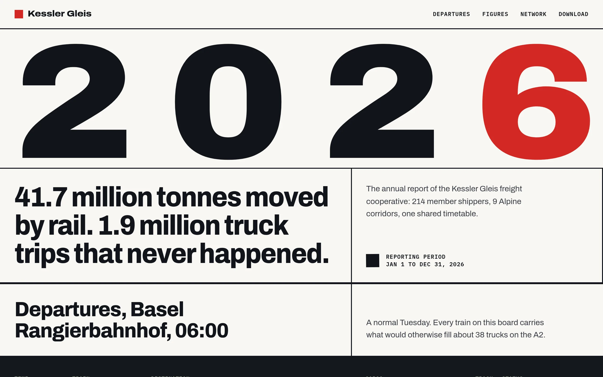
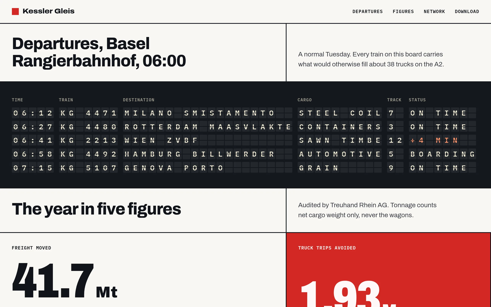
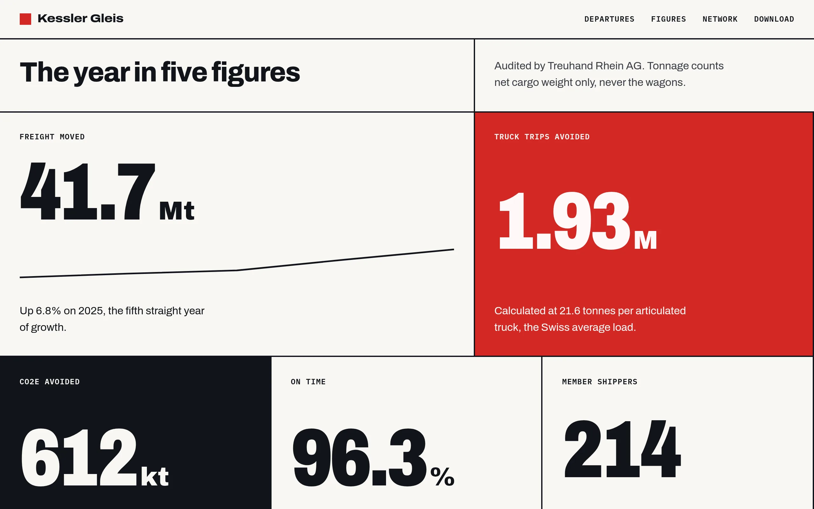
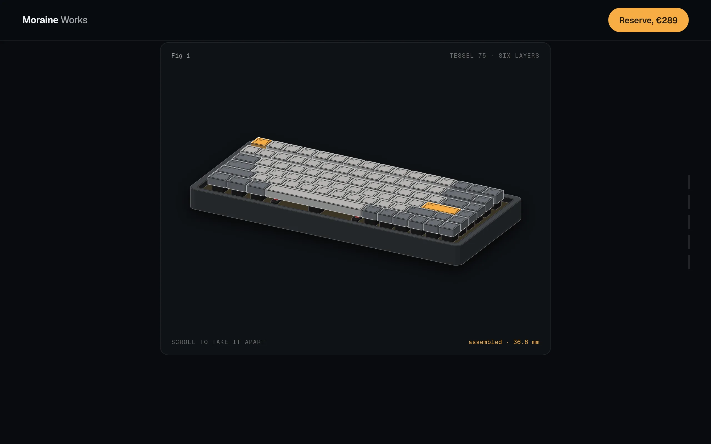
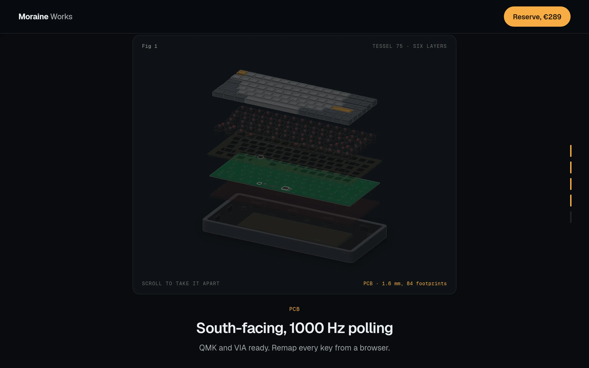
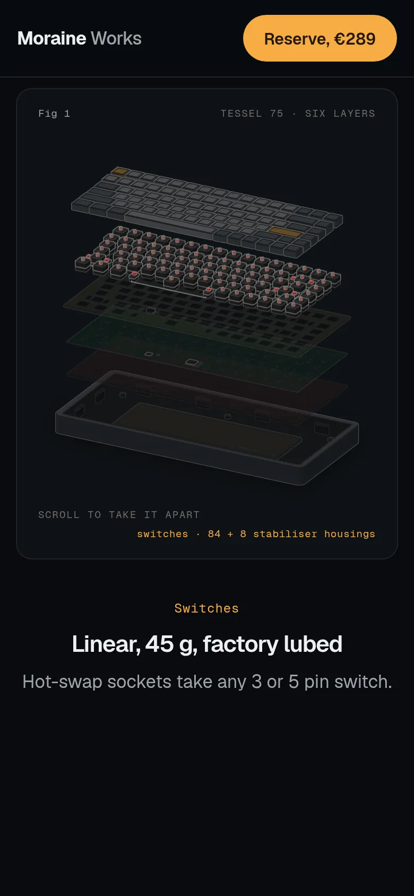
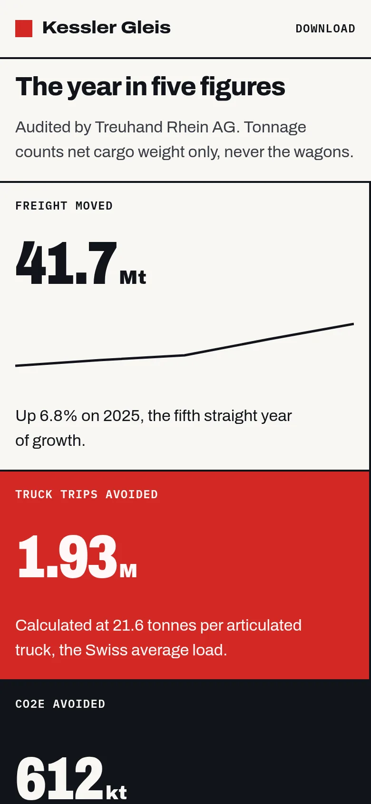

# Design & Taste: a merged skill for Claude Code / Cowork

One installable skill that gives Claude elite frontend design taste: it builds interfaces that feel premium instead of generic, with stronger typography, color, spacing, motion, component states, and accessibility, and a built-in critique pass so it doesn't stop at the first draft.

## Where it comes from

This is a **synthesis of three community design skills**, deduplicated and merged. All three share the same anti-slop, taste-first lineage; each contributed its unique strength:

| Source | What it contributed to this skill |
|--------|-----------------------------------|
| [emilkowalski/skill](https://github.com/emilkowalski/skill) (`emil-design-eng`) | The craft philosophy ("taste is trained", "unseen details compound") and the deep motion/animation craft → `reference/motion.md` |
| [pbakaus/impeccable](https://github.com/pbakaus/impeccable) | The crisp design rules, the OKLCH color strategy, the **absolute anti-slop bans**, and the modern interaction-states reference → `SKILL.md` core rules + `reference/anti-slop.md` + `reference/interaction-states.md` |
| [leonxlnx/taste-skill](https://github.com/leonxlnx/taste-skill) (`design-taste-frontend`) | Reading the brief before designing, the three intensity dials, honest design-system selection, GSAP scroll skeletons, redesign protocol, bias-correction rules, dark mode protocol, and the full pre-flight matrix → `reference/design-systems.md` + `reference/core-rules.md` + `reference/pre-flight.md` |

Rather than install three overlapping skills (they repeat the same mindset), this combines them: one self-contained `SKILL.md` core plus six focused reference files pulled faithfully from the originals.

## Structure

```
design-taste/
├── SKILL.md                       # Synthesized core: philosophy, Iron Law, brief-read, routing, section index
├── CHANGELOG.md                   # Version history (Keep a Changelog)
├── .claude-plugin/plugin.json     # Plugin manifest (name, version, license, keywords)
├── reference/
│   ├── motion.md                  # Animation craft (emil): easing, springs, clip-path, stagger, perf, Sonner
│   ├── interaction-states.md      # Components (impeccable): 8 states, focus rings, dialog/popover, keyboard nav
│   ├── anti-slop.md               # The ban + AI-tells catalogue (impeccable + taste-skill)
│   ├── core-rules.md              # Design engineering directives + dark mode protocol (taste-skill Sections 4, 8)
│   ├── design-systems.md          # Brief read, dials, real-vs-fake design systems, GSAP skeletons, redesign protocol (taste-skill)
│   └── pre-flight.md              # Review format + pre-flight core/mode addenda (emil + taste-skill + impeccable)
├── scripts/
│   ├── preflight.mjs              # Zero-dependency pre-flight scanner (run this before shipping)
│   └── upstream-drift.sh          # Report-only drift check against the three upstream sources
├── templates/                     # Standalone HTML pages built with this skill (open in a browser)
│   ├── swiss-report.html          # Swiss / brutalist annual report: split-flap board, counters, drawn network map
│   ├── depth-launch.html          # Product launch: isometric keyboard that comes apart in six layers on scroll
│   ├── depth-launch-lite.html     # Same page with a light CSS-3D keyboard (23 KB instead of 930 KB)
│   └── build/anatomy-keyboard.mjs # Generator for depth-launch.html (needs the Anatomy kit)
└── docs/images/                   # Screenshots used in this README
```

## Templates

Two complete pages that show what the skill produces at full intensity. Each is one self-contained HTML file: open it in a browser, or hand it to Claude as a starting point ("use templates/swiss-report.html as the base for our report page"). Brands and figures are fictional.

### Swiss report (`templates/swiss-report.html`)

An annual report for a rail-freight cooperative in the International Typographic Style: a hard 12-column grid, one signal-red accent, Archivo with its width axis animated.

<p></p>

| | |
|---|---|
|  |  |

Motion: the year widens on load, the departure board flaps letter by letter and keeps updating, figures count up, bars rise with a mechanical ease, the network map draws itself with the new corridor last, and the closing statement lights word by word as you read. All of it has a reduced-motion fallback. Light theme only, by design (a printed report).

### Depth launch (`templates/depth-launch.html`)

A dark product launch for a 75% keyboard. The sticky section shows an isometric figure of about 575 solids (keycaps, switches with stabilisers, FR4 plate, PCB, foam, aluminium case with gaskets and weight) that comes apart in six layers as you scroll, with a live readout and captions in step.

| | |
|---|---|
|  |  |

Also on the page: a sound demo that synthesizes switch clicks in the browser (tap the pad or type on your own keyboard; keys press on the figure too), a colourway picker with a circular view-transition reveal that recolours the figure, and a static layout used under reduced motion or when GSAP cannot load. Scrubbing holds 60 fps on a 390 px phone profile with 4x CPU throttle.

<p> </p>

The keyboard figure is generated with the [Anatomy](https://github.com/wheresryan22/anatomy) kit (MIT). To rebuild it, clone Anatomy next to this repo (or set `ANATOMY_DIR`) and run `node templates/build/anatomy-keyboard.mjs`; it starts from `depth-launch-lite.html` and writes `depth-launch.html`. GSAP 3.12.5 loads from cdnjs with Subresource Integrity.

## Install

Repo: **https://github.com/h3nryprod01/design-taste**

**From GitHub (recommended):**
```bash
# via the agent-skills CLI (works for Claude Code, Cowork, Cursor, etc.)
npx skills add h3nryprod01/design-taste

# or clone straight into your personal skills dir
git clone https://github.com/h3nryprod01/design-taste.git ~/.claude/skills/design-taste
```

**Claude Code, global (all projects):**
```bash
cp -r design-taste ~/.claude/skills/
```

**Claude Code, single project:**
```bash
mkdir -p .claude/skills && cp -r design-taste .claude/skills/
```

**Claude Desktop / Web / Cowork:** zip the `design-taste` folder and upload it under Settings → Capabilities → Skills.

## Usage

It activates automatically on design requests ("make this landing page look better", "build a premium pricing page", "polish this dashboard's UI", "improve the animations", "this feels like AI slop, fix it") or invoke explicitly: *"use the design-taste skill to…"*.

## Credits & license

This is a **mixed-license** package, because the upstream sources use different licenses. The split is documented precisely in [`NOTICE`](NOTICE) (per-file provenance map).

| Part | Source | License |
|------|--------|---------|
| `README.md` (new synthesis), `templates/`, `docs/images/` | - | **MIT** ([`LICENSE`](LICENSE)); the keyboard figure in `templates/depth-launch.html` is generated with [wheresryan22/anatomy](https://github.com/wheresryan22/anatomy) (MIT) |
| `reference/motion.md` | [emilkowalski/skill](https://github.com/emilkowalski/skill) | MIT |
| `SKILL.md` (the Core design rules passages itemized in `NOTICE`, Routing mode register), `reference/interaction-states.md`, `reference/anti-slop.md` (Part 1), `reference/pre-flight.md` (Addendum: Operate) | [pbakaus/impeccable](https://github.com/pbakaus/impeccable) | **Apache-2.0** ([`LICENSES/Apache-2.0.txt`](LICENSES/Apache-2.0.txt)) |
| `SKILL.md` (remainder, new synthesis), `reference/anti-slop.md` (Part 2), `reference/core-rules.md`, `reference/design-systems.md`, `reference/pre-flight.md` (remainder) | [leonxlnx/taste-skill](https://github.com/leonxlnx/taste-skill) / new synthesis | MIT |

The original synthesis is © 2026 Nguyễn Phú Cường under MIT. The impeccable-derived files remain under Apache-2.0 (impeccable itself derives, in part, from Anthropic's `frontend-design` skill, also Apache-2.0, attribution preserved transitively in `NOTICE`). When redistributing, keep `LICENSE`, `LICENSES/Apache-2.0.txt`, and `NOTICE` together.
